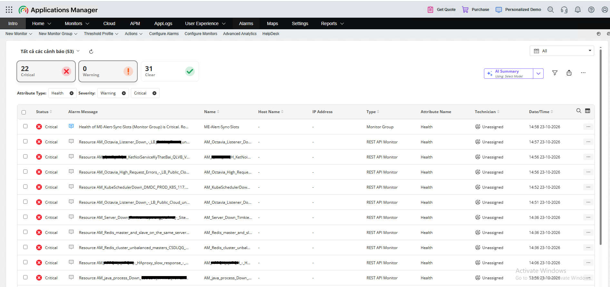
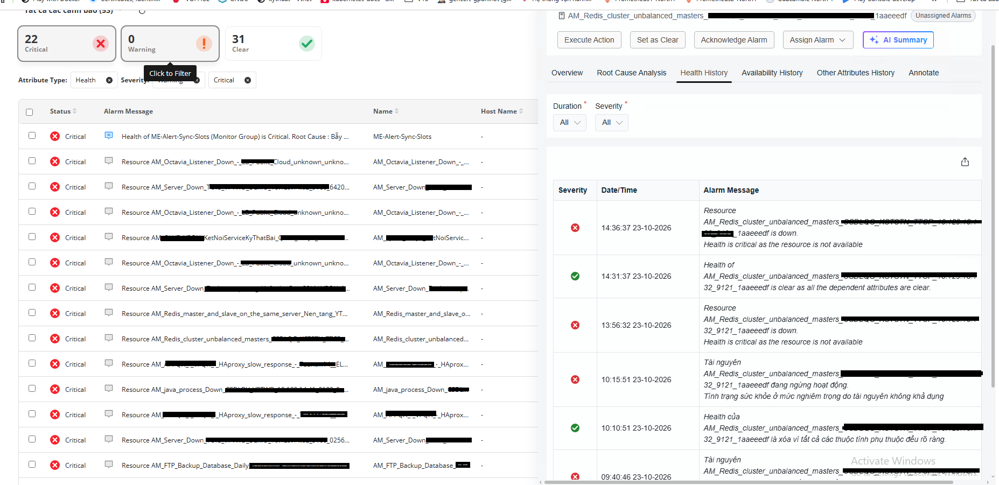

# AltoMe

AltoMe là gateway đồng bộ cảnh báo từ Alertmanager sang ManageEngine Applications Manager (AppManager).

```
Alertmanager -> AltoMe -> AppManager RESTAPIMonitor
```

AltoMe nhận Alertmanager webhook v4, lưu bền vững vào SQLite, tạo một REST monitor riêng cho từng fingerprint, cập nhật trạng thái firing/resolved và tự retry khi AppManager tạm thời không khả dụng.

## 1. Mục đích

- Tự động đưa cảnh báo Alertmanager lên AppManager.
- Hiển thị alarm riêng cho từng alert thực tế.
- Không giới hạn số alert bởi resource/attribute slot cố định.
- Không sử dụng SNMP hoặc Trap.
- Không mất alert khi gateway hoặc AppManager tạm thời lỗi.
- Giữ mapping giữa fingerprint và resourceid AppManager để clear đúng alarm.

## 2. Tính năng

- Nhận POST /alertmanager-webhook theo Alertmanager webhook v4.
- SQLite queue bền vững, WAL, retry exponential backoff.
- Idempotency theo fingerprint.
- Một firing alert tạo tối đa một RESTAPIMonitor.
- Alert cùng alertname nhưng khác instance/application tạo monitor riêng.
- Alert resolved trả trạng thái OK và được giữ theo retention trước khi cleanup.
- Re-fire cùng fingerprint trước cleanup dùng lại monitor cũ.
- Tên monitor: `AM_<alertname>_<application>_<instance>_<fingerprint-8>`.
- Mapping: annotations.summary -> nội dung; labels.alertname -> tên; labels.application (fallback labels.app) -> application; labels.instance -> IP/instance; fingerprint -> định danh.
- Feed riêng: `GET /appmanager-feed/{fingerprint}` với `Authorization: Bearer <token>`.
- API vận hành: `/health`, `/ready`, `/metrics`, `/api/v1/alert-mappings`.

## Ảnh minh họa

Các ảnh dưới đây minh họa cảnh báo đã được AltoMe đồng bộ và hiển thị trên AppManager:





## 3. Cài đặt bằng Docker

Yêu cầu: Docker Engine/Compose, AppManager HTTPS API, API key AppManager và Alertmanager truy cập được port 18082. Image production là `altome:v2`; cấu hình runtime nằm trong một file `altome.conf`, nên đổi cấu hình không cần build lại image.

```bash
git clone https://github.com/haiops18/AltoMe.git
cd me-alert-sync
mkdir -p data secrets
printf '%s' 'APP_MANAGER_API_KEY' > secrets/me_api_key
printf '%s' 'WEBHOOK_PASSWORD' > secrets/webhook_password
printf '%s' 'LONG_RANDOM_FEED_TOKEN' > secrets/feed_token
chmod 600 secrets/*
chown 10001:10001 secrets secrets/* data
chmod 700 secrets data
```

Nếu máy triển khai chưa có image, nạp image đã build sẵn một lần:

```bash
docker load -i image/altome-v2.tar
```

### Cấu hình `altome.conf`

Sửa trực tiếp file `altome.conf`. Mỗi biến đã có một dòng chú thích mô tả ngay phía trên; không cần sửa Dockerfile hoặc build lại image. Các giá trị bí mật vẫn để trong `secrets/` và được mount read-only để không phải ghi password/API key vào file cấu hình hoặc Git.

```dotenv
# Xem altome.conf; file thật đã có chú thích cho từng biến.
```

Khởi động:

```bash
docker compose up -d
docker compose ps
docker compose logs -f --tail=100 me-alert-sync
curl -fsS http://127.0.0.1:18082/health
curl -fsS http://127.0.0.1:18082/ready
curl -fsS http://127.0.0.1:18082/metrics
```

Sau mỗi lần đổi `altome.conf`, chỉ cần chạy lại:

```bash
docker compose up -d
```

Compose sẽ dùng lại image `altome:v2`; dữ liệu SQLite vẫn nằm trong thư mục `data/`.

`ME_SLOT_ATTRIBUTE_IDS` chỉ dùng khi rollback về `legacy_slots`; không dùng trong chế độ mặc định.

## 4. Cấu hình Alertmanager

```yaml
receivers:
  - name: altome
    webhook_configs:
      - url: 'http://altome:18082/alertmanager-webhook'
        send_resolved: true
        max_alerts: 0
        http_config:
          basic_auth:
            username: alertmanager
            password_file: /etc/alertmanager/secrets/webhook_password
```

## 5. Thông số cần cấu hình

| Biến | Ý nghĩa |
|---|---|
| LISTEN_HOST, LISTEN_PORT | Địa chỉ và port HTTP AltoMe |
| WEBHOOK_USER, WEBHOOK_PASSWORD_FILE | Basic Auth webhook |
| ME_URL | URL AppManager |
| ME_API_KEY_FILE | API key AppManager |
| ME_VERIFY_TLS | Kiểm tra certificate TLS |
| ME_TIMEOUT | Timeout gọi AppManager, giây |
| ME_RESOURCE_ID | Resource/group AppManager |
| APPMANAGER_INTEGRATION_MODE | dynamic_rest_monitor hoặc legacy_slots |
| ME_FEED_BASE_URL | URL AltoMe mà AppManager poll |
| ME_FEED_TOKEN_FILE | Bearer token feed |
| RESOLVED_MONITOR_RETENTION_HOURS | Thời gian giữ monitor resolved |
| DB_PATH | SQLite persistent database |
| RETRY_SECONDS, SYNC_INTERVAL | Retry và chu kỳ đồng bộ |
| MAX_BODY_BYTES | Giới hạn webhook |
| LOG_LEVEL | Mức log |

Không ghi API key, password hoặc feed token vào log, URL query string hay Git.

## 6. Xử lý các tình huống

### AppManager không truy cập được

```bash
ss -ltnp | grep 8444
curl -kI https://APP_MANAGER_IP:8444/
docker compose logs --tail=100 me-alert-sync
```

Alert vẫn nằm trong SQLite và được retry.

### Queue còn pending

Kiểm tra `/metrics`, đặc biệt `me_alert_queue_depth` và `me_alert_appmanager_errors`. Sau khi AppManager hoạt động, worker tự xử lý lại.

### Không thấy alarm

Kiểm tra AppManager port 8444, API key, `ME_FEED_BASE_URL`, token và mapping:

```bash
curl -i -H 'Authorization: Bearer <token>' http://ALTOME_HOST:18082/appmanager-feed/<fingerprint>
curl -u alertmanager:PASSWORD http://127.0.0.1:18082/api/v1/alert-mappings/<fingerprint>
```

### Resolved chưa clear

Bảo đảm `send_resolved: true`; kiểm tra log `MONITOR_RESOLVED`. Không xóa mapping ngay vì monitor được giữ theo retention.

### Gateway restart

```bash
docker compose restart me-alert-sync
```

Mapping và retry state được đọc lại từ SQLite; không tạo monitor trùng.

### Backup/restore

```bash
docker compose stop me-alert-sync
cp data/alerts.sqlite3 /backup/alerts.sqlite3
docker compose start me-alert-sync
```

Không xóa volume trước khi đối chiếu monitor trên AppManager.

### AppManager tự dừng

```bash
/opt/ManageEngine/AppManager/bin/apm_wrapper.sh status
cd /opt/ManageEngine/AppManager
./startApplicationsManager.sh -d
```

## 7. Kiểm thử

```bash
python3 -m unittest discover -s tests -v
docker compose ps
curl -fsS http://127.0.0.1:18082/health
```

Cần xác nhận firing tạo đúng một monitor, firing lặp không tạo monitor thứ hai, instance khác nhau tạo monitor riêng, resolved clear đúng monitor và AppManager lỗi không làm mất alert.

## 8. Rollback

Đổi cấu hình:

```dotenv
APPMANAGER_INTEGRATION_MODE=legacy_slots
```

Sau đó cấu hình `ME_SLOT_ATTRIBUTE_IDS` và restart container. Chế độ khuyến nghị vẫn là `dynamic_rest_monitor`.
